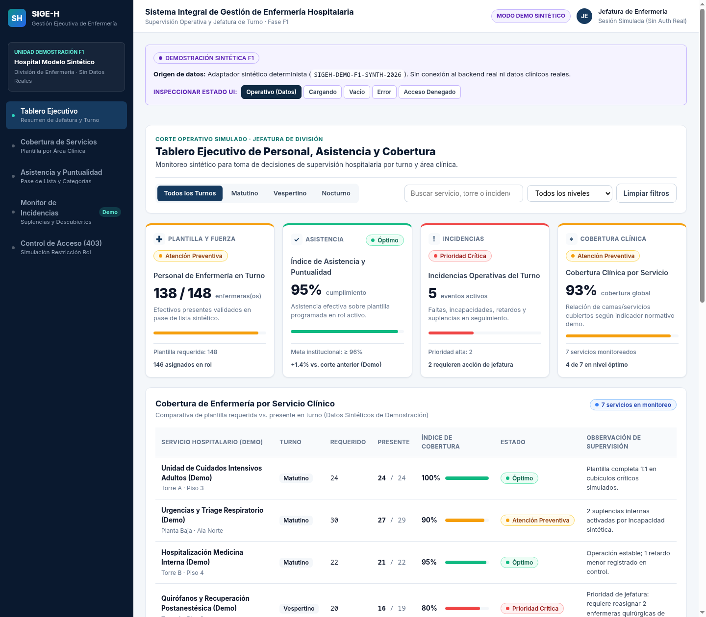
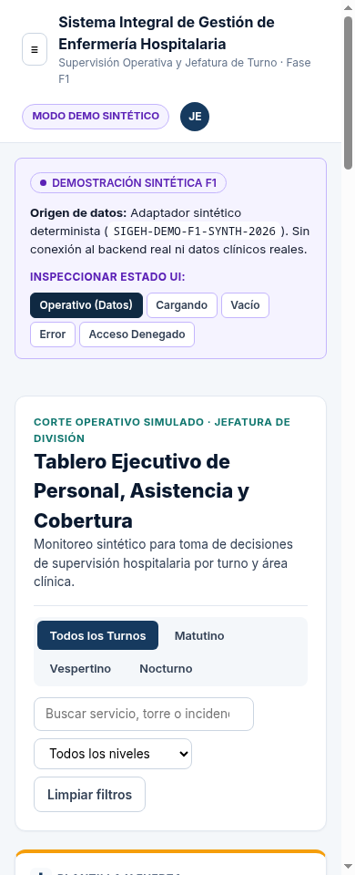
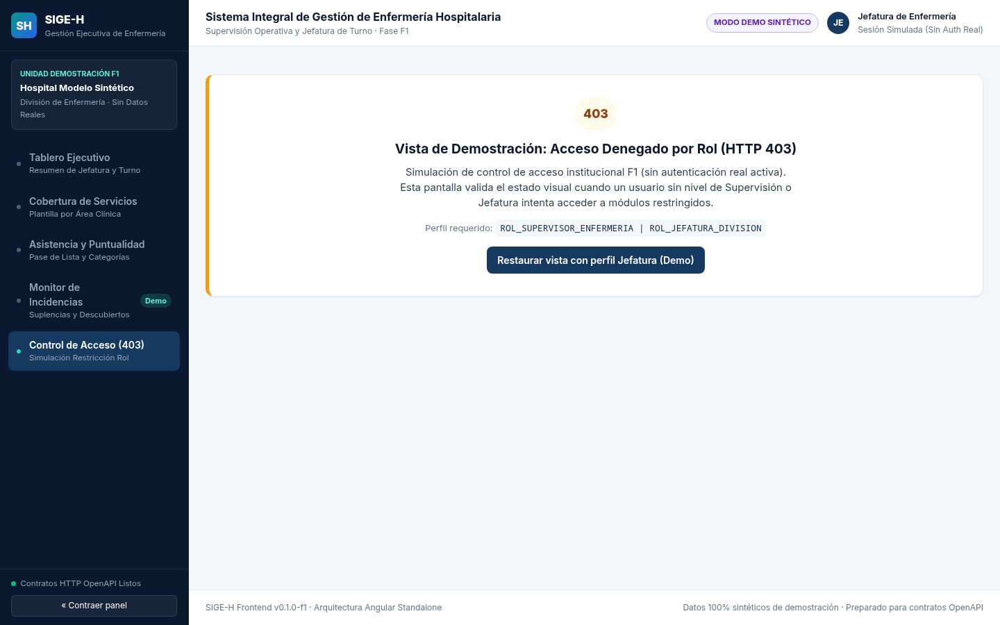

# Informe de Entrega — Fase F1: Fundación Angular y Dashboard Ejecutivo (SIGE-H)

- **Proyecto:** SIGE-H (`SIGE-H-Frontend`)
- **Fase:** F1 — Fundación Angular y Dashboard Ejecutivo
- **Framework:** Angular `22.2.x` (Standalone, Signals, `OnPush`, SCSS)
- **Estado de Entrega:** **PASS**

---

## 1. Arquitectura Angular Standalone, Modular y Escalable

Se implementó una arquitectura limpia y desacoplada por capas dentro de `src/app/` y `src/styles/`:

- **Capa Core (`src/app/core/`)**:
  - `config/environment.config.ts`: Token de inyección (`SIGEH_RUNTIME_CONFIG`) que explicita la fase `F1`, el modo `SYNTHETIC_DEMO` y mantiene `openApiBaseUrl: null` para impedir tráfico no autorizado o invención de endpoints reales.
  - `models/executive-dashboard.model.ts`: Contratos TypeScript inmutables para indicadores (`KpiMetric`), cobertura por servicio (`ServiceCoverageItem`), balance de asistencia (`AttendanceSummary`), incidencias (`OperationalIncident`) y estados de interfaz (`ViewStateStatus`).
  - `ports/executive-dashboard.gateway.ts`: Puerto abstracto (`EXECUTIVE_DASHBOARD_GATEWAY`) que desacopla los componentes visuales respecto al origen de datos.
  - `adapters/synthetic-executive-dashboard.adapter.ts`: Adaptador determinista de datos sintéticos claramente etiquetados como demostración (`SIGEH-DEMO-F1-SYNTH-2026`).
  - `http/openapi-client.base.ts` y `http/executive-dashboard-http.service.ts`: Servicios HTTP tipados sobre `HttpClient` listos para enlazar contratos OpenAPI en fases posteriores (`F2+`), con construcción tipada de `HttpParams`, cabeceras de trazabilidad y normalización de errores (`403 Forbidden`, errores de red y guarda de configuración).

- **Capa de Sistema de Diseño y Componentes Compartidos (`src/styles/` y `src/app/shared/`)**:
  - Tokens SCSS (`_tokens.scss`), mixins responsivos (`_mixins.scss`), primitivas de layout (`_layout.scss`) y superficies institucionales (`_components.scss`).
  - `StatusBadgeComponent`: Insignias semánticas (`Óptimo`, `Atención Preventiva`, `Prioridad Crítica`, severidades e identificador `Demostración Sintética F1`).
  - `KpiStatCardComponent`: Tarjeta ejecutiva reutilizable con valor principal, meta normativa, barra de cumplimiento y tendencia.
  - `UiStatePanelComponent`: Componente unificado para los estados `loading`, `empty`, `error` y `forbidden` (`403`).
  - `DemoModeBannerComponent`: Banner institucional que identifica permanentemente el origen sintético de los datos y ofrece un conmutador interactivo para inspeccionar todos los estados de UI.

- **Capa de Layout (`src/app/layout/shell/`)**:
  - `InstitutionalShellComponent`: Estructura institucional con sidebar colapsable en escritorio, cajón deslizante (*off-canvas drawer*) con *backdrop* en móvil, encabezado con indicador de sesión simulada y pie institucional.

- **Capa de Funcionalidades (`src/app/features/`)**:
  - `ExecutiveDashboardComponent` (`/dashboard`): Tablero ejecutivo para supervisión y jefaturas de enfermería con filtrado por turno (`Matutino`, `Vespertino`, `Nocturno`, `Todos`), búsqueda por servicio/torre/incidencia y filtro por nivel de alerta.
  - `AccessDeniedPageComponent` (`/acceso-restringido`): Ruta dedicada para demostración de restricción de acceso por perfil (`HTTP 403`) con acción de retorno al tablero.

---

## 2. Funcionalidades del Dashboard Ejecutivo

1. **Indicadores Clave (4 KPIs Ejecutivos)**:
   - **Personal de Enfermería en Turno** (efectivos presentes vs. plantilla requerida).
   - **Índice de Asistencia y Puntualidad** (porcentaje de cumplimiento y variación contra corte previo).
   - **Incidencias Operativas del Turno** (eventos activos y conteo de severidad crítica).
   - **Cobertura Clínica por Servicio** (porcentaje global y proporción de servicios en estado óptimo).
2. **Matriz de Cobertura por Servicio Clínico**:
   - Tabla responsiva con servicios simulados (`UCI Adultos (Demo)`, `Urgencias y Triage (Demo)`, `Quirófanos (Demo)`, `Pediatría (Demo)`, etc.), turno, plantilla requerida/asignada/presente, barra de cobertura y observaciones de supervisión.
3. **Balance de Asistencia y Distribución por Categoría**:
   - Resumen de puntualidad, suplencias activas, ausencias justificadas, faltas/retardos y disponibilidad por categoría (`Enfermería Especialista`, `Enfermería General`, `Auxiliar de Enfermería`, `Supervisión y Jefatura de Piso`).
4. **Monitor de Incidencias del Turno**:
   - Lista priorizada de eventos sintéticos (`INC-DEMO-101` a `INC-DEMO-105`) con severidad, servicio, hora de reporte y estado de resolución (`Pendiente de Cobertura`, `Suplencia Asignada`, `En Revisión Jefatura`).
5. **Estados de Interfaz Completos**:
   - `ready` (Operativo con datos sintéticos)
   - `loading` (Esqueleto y spinner de sincronización)
   - `empty` (Sin coincidencias con botón para restablecer filtros)
   - `error` (Diagnóstico de fallo con acción de reintento)
   - `forbidden` (Estado `403` por nivel de supervisión con restauración de vista demo)

---

## 3. Verificación Técnica: Build, Pruebas Unitarias y Revisión Visual

### 3.1 Build de Producción (`npm run build`)
- **Resultado:** Exitoso (`exit code 0`), **0 errores y 0 advertencias** de presupuesto de estilos (`budgets`).
- **Bundle generado:** `dist/SIGE-H-Frontend` (`361.49 kB` raw / `92.75 kB` transfer estimada).

### 3.2 Pruebas Unitarias (`npx ng test --watch=false`)
- **Runner:** Vitest `v5.1.0` + Angular `TestBed`.
- **Resultado:** **5 suites aprobadas (5/5), 13 pruebas unitarias aprobadas (13/13)**:
  - `src/app/app.spec.ts` (1 prueba)
  - `src/app/core/adapters/synthetic-executive-dashboard.adapter.spec.ts` (5 pruebas)
  - `src/app/core/http/executive-dashboard-http.service.spec.ts` (2 pruebas)
  - `src/app/features/executive-dashboard/executive-dashboard.component.spec.ts` (3 pruebas)
  - `src/app/layout/shell/institutional-shell.component.spec.ts` (2 pruebas)

### 3.3 Revisión Visual en Navegador (Escritorio y Móvil)
Se ejecutó verificación visual automatizada con `Chromium` headless sobre el bundle compilado, validando la ausencia de desbordamientos horizontales, la legibilidad tipográfica y la adaptación responsiva:

- **Vista Escritorio (`1440x1260`) — Tablero Ejecutivo**:
  
- **Vista Móvil (`390x960`) — Navegación y Filtros Responsivos**:
  
- **Vista Estado Acceso Denegado (`1440x900`) — Ruta `/acceso-restringido`**:
  

---

## 4. Cumplimiento de Restricciones y Bloqueos

- **Trabajo exclusivo en `SIGE-H-Frontend`:** Cumplido.
- **Sin acceso ni cambios a backend, PostgreSQL, NestJS o IAM:** Cumplido.
- **Sin invención de endpoints reales ni autenticación real:** Cumplido.
- **Sin información hospitalaria real:** Cumplido (todos los registros están etiquetados como simulación sintética `Demo`).
- **Sin commits ni pushes:** Cumplido.
- **Bloqueos detectados:** Ninguno.

---

## 5. Conclusión

**PASS**
