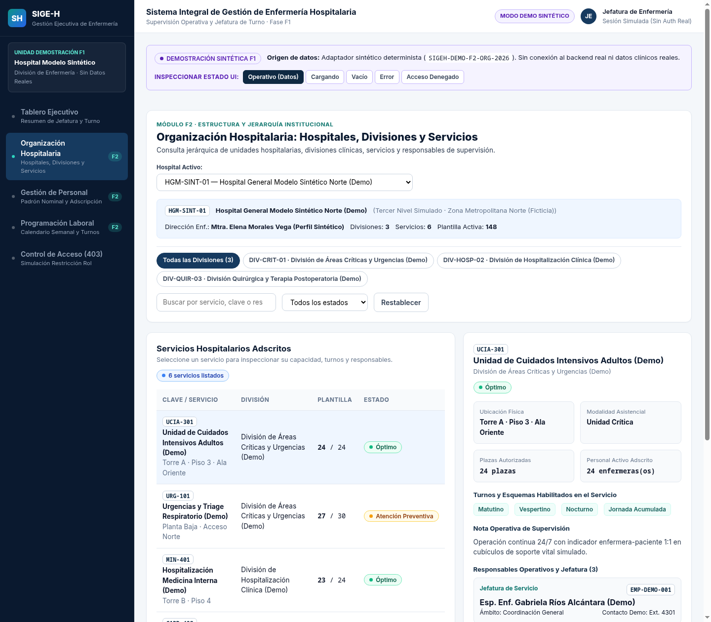
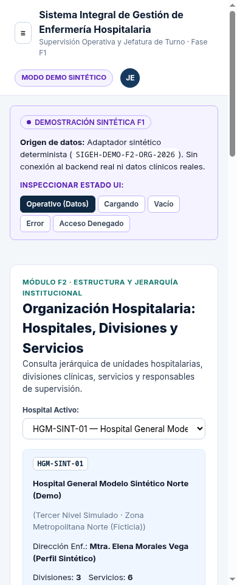
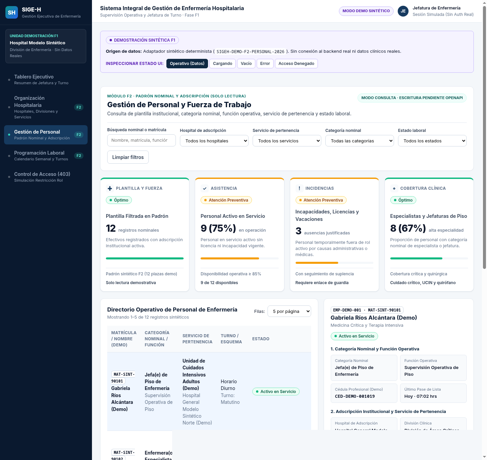
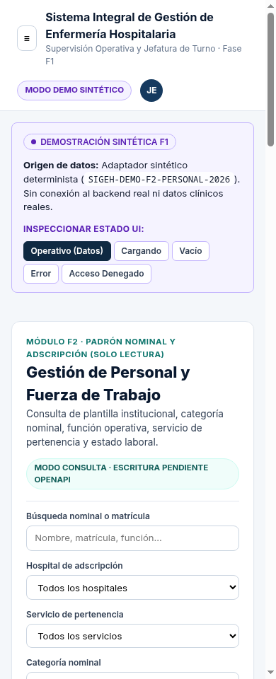
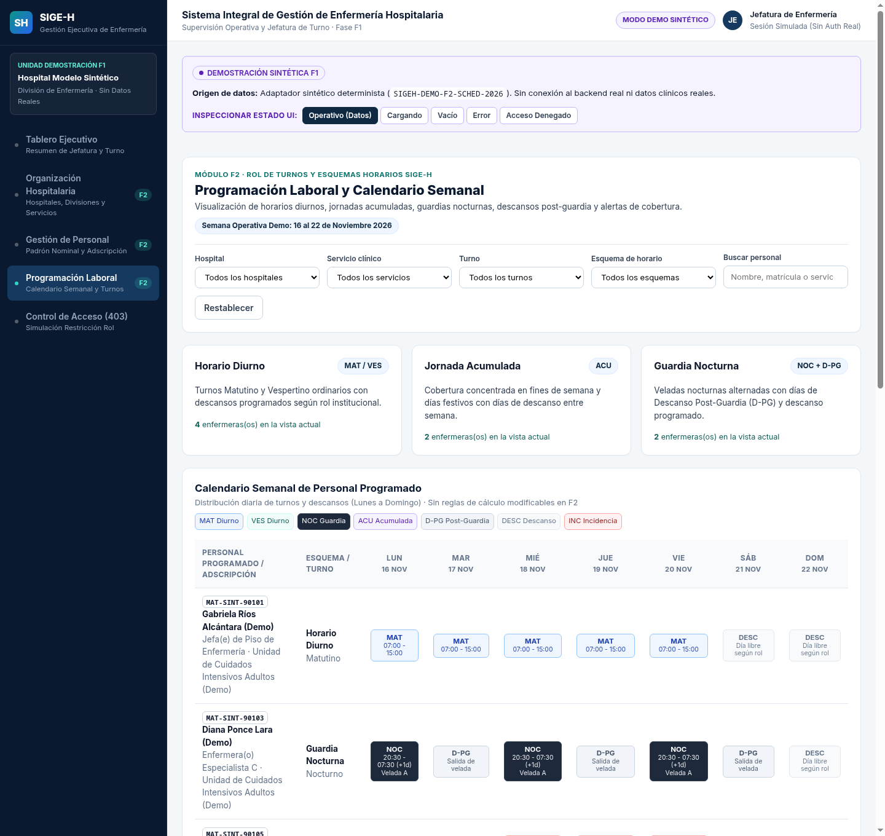
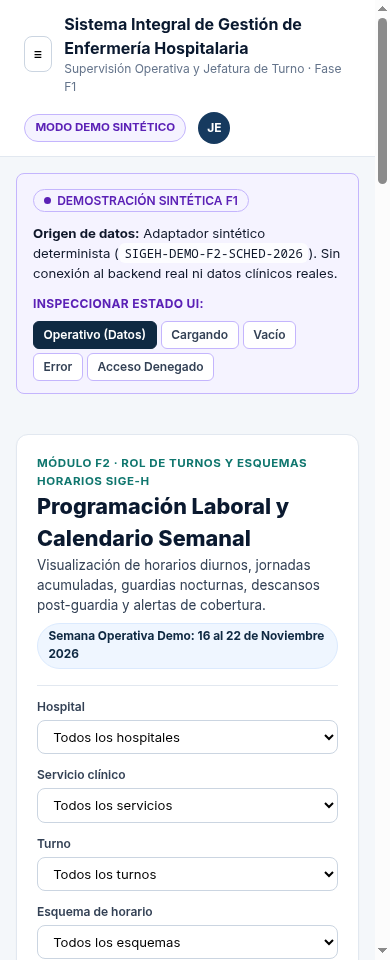

# Informe de Entrega — Fase F2: Organización, Personal y Programación (SIGE-H)

- **Proyecto:** SIGE-H (`SIGE-H-Frontend`)
- **Fase:** F2 — Organización Hospitalaria, Gestión de Personal y Programación Laboral
- **Estado de Entrega:** **PASS**

---

## 1. Estado General de la Fase

**Resultado:** **PASS**

Se construyeron y validaron los tres módulos visuales profesionales y navegables de F2 reutilizando los tokens SCSS y componentes institucionales de F1, manteniendo puertos desacoplados, adaptadores sintéticos claramente identificados y clientes HTTP tipados listos para enlazar contratos OpenAPI sin inventar endpoints reales ni habilitar escrituras no autorizadas.

---

## 2. Pantallas, Módulos y Componentes Creados

### 2.1 Organización Hospitalaria (`/organizacion`)
- **Componente principal:** `src/app/features/organization-explorer/organization-explorer.component.ts` (`.html`, `.scss`).
- **Modelos y contratos:** `src/app/core/models/organization.model.ts` y `src/app/core/ports/organization.gateway.ts`.
- **Adaptador sintético:** `src/app/core/adapters/synthetic-organization.adapter.ts` (`SIGEH-DEMO-F2-ORG-2026`).
- **Cliente HTTP tipado OpenAPI-ready:** `src/app/core/http/organization-http.service.ts`.
- **Funcionalidades:**
  - Selector de hospital con tarjeta institucional de resumen (código, nivel simulado, dirección de enfermería, conteo de divisiones, servicios y plantilla activa).
  - Explorador jerárquico **Hospital → División → Servicio** respetando el modelo SIGE-H sin inventar facultades administrativas.
  - Filtros por división, estado operativo y búsqueda por clave, servicio o responsable.
  - Panel maestro-detalle con **Ficha de Detalle de Servicio y Responsables** (ubicación física, modalidad asistencial, plazas autorizadas vs. personal activo, turnos/esquemas habilitados y lista de responsables por turno).
  - Estados completos: `ready`, `loading`, `empty`, `error` y `forbidden` (`403`).

### 2.2 Gestión de Personal (`/personal`)
- **Componente principal:** `src/app/features/personnel-management/personnel-management.component.ts` (`.html`, `.scss`).
- **Modelos y contratos:** `src/app/core/models/personnel.model.ts` y `src/app/core/ports/personnel.gateway.ts`.
- **Adaptador sintético:** `src/app/core/adapters/synthetic-personnel.adapter.ts` (`SIGEH-DEMO-F2-PERSONAL-2026`).
- **Cliente HTTP tipado OpenAPI-ready:** `src/app/core/http/personnel-http.service.ts`.
- **Funcionalidades:**
  - **Indicadores de plantilla** (4 tarjetas KPI: Plantilla filtrada en padrón, Personal activo en servicio, Incapacidades/Licencias/Vacaciones y Especialistas/Jefaturas).
  - **Tabla de personal con búsqueda, filtros combinados** (hospital, servicio de pertenencia, categoría nominal, estado laboral) y **paginación funcional** (tamaño de página configurable y navegación de páginas).
  - **Ficha de Detalle de Empleado** con:
    1. Categoría nominal y función operativa (incluyendo cédula demo y último pase de lista).
    2. Adscripción institucional y servicio de pertenencia (hospital, división, servicio, código de plaza, modalidad, esquema horario y antigüedad demo).
    3. Estado laboral y observaciones de supervisión.
  - Etiquetado explícito de **Modo Consulta (Solo Lectura)** hasta contar con endpoints de escritura y autorización IAM.
  - Estados completos: `ready`, `loading`, `empty`, `error` y `forbidden` (`403`).

### 2.3 Programación Laboral Semanal (`/programacion`)
- **Componente principal:** `src/app/features/work-scheduling/work-scheduling.component.ts` (`.html`, `.scss`).
- **Modelos y contratos:** `src/app/core/models/scheduling.model.ts` y `src/app/core/ports/scheduling.gateway.ts`.
- **Adaptador sintético:** `src/app/core/adapters/synthetic-scheduling.adapter.ts` (`SIGEH-DEMO-F2-SCHED-2026`).
- **Cliente HTTP tipado OpenAPI-ready:** `src/app/core/http/scheduling-http.service.ts`.
- **Funcionalidades:**
  - **Identificación de esquemas horarios SIGE-H**: Tarjetas resumen diferenciando **Horario Diurno** (`MAT / VES`), **Jornada Acumulada** (`ACU`) y **Guardia Nocturna** (`NOC + Descanso Post-Guardia D-PG`), respetando las particularidades de turnos y descansos sin inventar reglas de cálculo.
  - **Calendario semanal (Lunes a Domingo)** con filtros por hospital, servicio clínico, turno, esquema de horario y búsqueda nominal.
  - Celdas diarias codificadas por tipo de asignación (`MAT`, `VES`, `NOC`, `ACU`, `D-PG`, `DESC`, `INC`).
  - **Visualización inicial de Incidencias y Alertas de Cobertura** semanal por servicio y turno.
  - Estados completos: `ready`, `loading`, `empty`, `error` y `forbidden` (`403`).

---

## 3. Verificación: Build y Pruebas Unitarias Superadas

### 3.1 Build de Producción (`npm run build`)
- **Estado:** Exitoso (`exit code 0`), **0 errores y 0 advertencias** de presupuesto (`budgets`).
- **Tamaño del bundle:** `456.20 kB` raw / `105.93 kB` transfer estimada.

### 3.2 Pruebas Unitarias (`npx ng test --watch=false`)
- **Runner:** Vitest `v5.1.0` + Angular `TestBed`.
- **Resultado:** **11 suites superadas (11/11), 29 pruebas unitarias superadas (29/29)**:
  1. `src/app/app.spec.ts` (1 prueba)
  2. `src/app/layout/shell/institutional-shell.component.spec.ts` (2 pruebas)
  3. `src/app/core/adapters/synthetic-executive-dashboard.adapter.spec.ts` (5 pruebas)
  4. `src/app/core/http/executive-dashboard-http.service.spec.ts` (2 pruebas)
  5. `src/app/features/executive-dashboard/executive-dashboard.component.spec.ts` (3 pruebas)
  6. `src/app/core/adapters/synthetic-organization.adapter.spec.ts` (3 pruebas)
  7. `src/app/core/adapters/synthetic-personnel.adapter.spec.ts` (3 pruebas)
  8. `src/app/core/adapters/synthetic-scheduling.adapter.spec.ts` (3 pruebas)
  9. `src/app/features/organization-explorer/organization-explorer.component.spec.ts` (3 pruebas)
  10. `src/app/features/personnel-management/personnel-management.component.spec.ts` (2 pruebas)
  11. `src/app/features/work-scheduling/work-scheduling.component.spec.ts` (2 pruebas)

---

## 4. Capturas de Escritorio y Móvil

### 4.1 Módulo 1: Organización Hospitalaria
- **Escritorio (`1440x1260`)**:
  
- **Móvil (`390x960`)**:
  

### 4.2 Módulo 2: Gestión de Personal
- **Escritorio (`1440x1360`)**:
  
- **Móvil (`390x960`)**:
  

### 4.3 Módulo 3: Programación Laboral Semanal
- **Escritorio (`1440x1360`)**:
  
- **Móvil (`390x960`)**:
  

---

## 5. Dependencias Concretas de OpenAPI para Integración Posterior

Los servicios HTTP tipados (`OrganizationHttpService`, `PersonnelHttpService`, `SchedulingHttpService`) ya están construidos sobre `OpenApiClientBaseService`. Para conmutar los tokens de inyección (`ORGANIZATION_GATEWAY`, `PERSONNEL_GATEWAY`, `SCHEDULING_GATEWAY`) de los adaptadores sintéticos hacia el backend real en fases posteriores se requiere:

1. **Contrato OpenAPI de Organización Hospitalaria**:
   - Operación de consulta jerárquica de Hospitales, Divisiones y Servicios con filtros `hospitalId`, `divisionId`, `searchQuery`, `statusFilter` y detalle de responsables por servicio (`OrganizationExplorerSnapshot`).
2. **Contrato OpenAPI de Gestión de Personal**:
   - Operación paginada de directorio nominal y adscripción con parámetros `hospitalId`, `serviceId`, `nominalCategory`, `employmentStatus`, `searchQuery`, `page`, `pageSize` e indicadores agregados de plantilla (`PersonnelDirectorySnapshot`).
3. **Contrato OpenAPI de Programación Laboral**:
   - Operación de consulta de calendario semanal con parámetros `hospitalId`, `serviceId`, `shiftFilter`, `schemeFilter`, `searchQuery`, devolviendo asignaciones diarias (`DIURNO_MATUTINO`, `DIURNO_VESPERTINO`, `GUARDIA_NOCTURNA`, `JORNADA_ACUMULADA`, `DESCANSO_POST_GUARDIA`, `DESCANSO_PROGRAMADO`, `INCIDENCIA_AUSENCIA`) y alertas de cobertura (`WeeklyScheduleSnapshot`).
4. **Configuración de URL Base (`SIGEH_RUNTIME_CONFIG.openApiBaseUrl`)**:
   - Actualmente fijada en `null` por diseño en F1/F2 para garantizar cero llamadas no autorizadas al backend.

---

## 6. Bloqueos Relevantes

- **Ningún bloqueo.** El frontend compila sin advertencias, supera las 29 pruebas unitarias y cuenta con navegación completa en escritorio y móvil.
